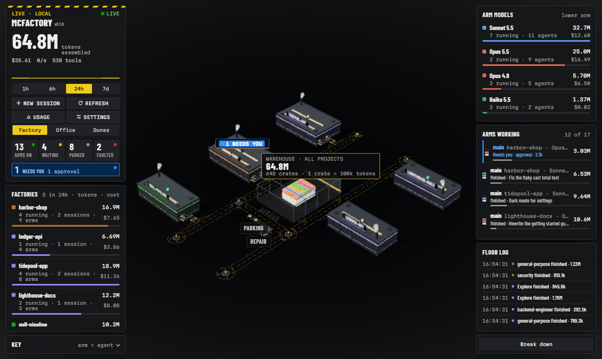
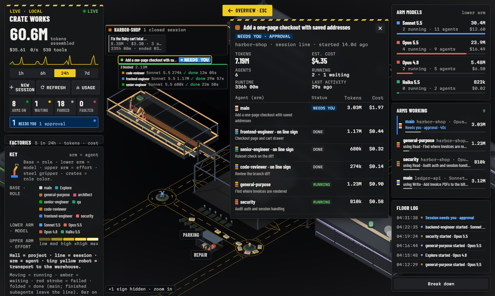
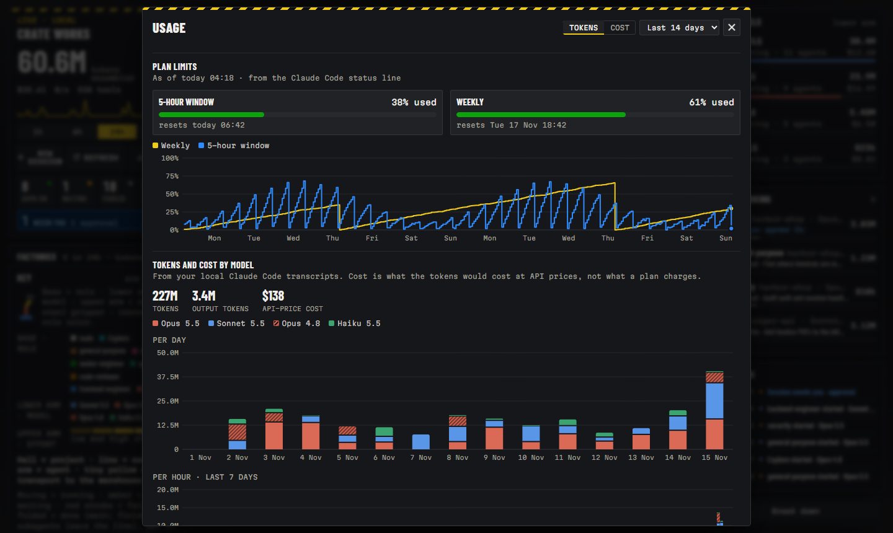

# McFactory

[](https://github.com/therealmcsparrow/McFactory/actions/workflows/validate.yml)
[](LICENSE)

**Your Claude Code activity as a live isometric factory.** Every project is a factory hall, every open session a conveyor line, every agent a robot arm, and every token a crate on its way to the warehouse. Chat with your sessions and answer their prompts from the same page.

It runs on your own computer and reads `~/.claude/projects`. Your session data never leaves your computer.



<sub>Screenshots use made-up demo data (`dev/demo/make-demo.js`).</sub>

## Contents

- [Features](#features)
- [Quick start](#quick-start)
- [Desktop app](#desktop-app)
- [Screenshots](#screenshots)
- [Documentation](#documentation)
- [Security and privacy](#security-and-privacy)
- [Contributing](#contributing)
- [License](#license)

## Features

- **See everything at a glance.** Halls, lines and arms show which sessions and agents are running, waiting or done. Arm colours show role, model and effort. Totals for tokens, estimated cost and tools are always on screen.
- **Two scenes.** Switch to the office view for the same data as office buildings, desks and people. Click a person to see their screen.
- **Needs you.** A blue beacon and signs show when a session waits for your answer or approval.
- **Start and chat with sessions.** Start a new Claude Code session in any folder, then chat with it, answer its permission prompts and questions, and use its slash commands.
- **Talk to terminal and desktop sessions.** Send messages to sessions you started in the Claude CLI or the desktop app.
- **Answer prompts from the dashboard.** An optional global hook shows the permission prompts of all your sessions as Allow / Deny cards. The first answer wins, so the terminal keeps working as before.
- **Usage.** Plan limits (5-hour and weekly) plus tokens and cost per day and hour, split by model.
- **Small install.** The server uses Node built-ins only; `npm ci` adds just the TypeScript compiler and the three.js types to build the page.

## Quick start

You need [Node.js](https://nodejs.org/) 22 or later and Claude Code.

```sh
git clone https://github.com/therealmcsparrow/McFactory.git
cd McFactory
npm ci
npm start
```

Open <http://127.0.0.1:4545>. If you have no status line yet, the server adds one to `~/.claude/settings.json` so it can read your plan limits (`--no-statusline` skips this).

To answer the prompts of your terminal sessions from the dashboard too:

```sh
node server.js --install-hook
```

Options, environment variables and tests are in [Getting started](documentation/getting-started.md).

## Desktop app

`desktop/` wraps the same page in a Tauri 2 window, with the server built in. Windows installers are attached to each [release](https://github.com/therealmcsparrow/McFactory/releases). See [Desktop app](documentation/desktop-app.md) to build it yourself.

## Screenshots

**A session up close.** Click a line for its session card: agents, tokens, cost and status. The session that needs you glows blue.



**Usage.** Plan limits over time, and tokens or cost per day by model.



## Documentation

| Guide | What it covers |
|-------|----------------|
| [Getting started](documentation/getting-started.md) | Requirements, starting the server, options, tests |
| [The factory view](documentation/factory-view.md) | What every hall, line, arm and crate means |
| [The office view](documentation/office-view.md) | The second scene: buildings, desks, people, the bank |
| [Chat and new sessions](documentation/chat.md) | Starting sessions from the dashboard and chatting with them |
| [Terminal and desktop sessions](documentation/peer-chat.md) | Sending messages to sessions you started elsewhere |
| [Answer prompts from the dashboard](documentation/permission-hook.md) | The global permission hook |
| [Usage and plan limits](documentation/usage.md) | The Usage view and where its numbers come from |
| [Desktop app](documentation/desktop-app.md) | The Tauri app |
| [HTTP API](documentation/api.md) | Every endpoint |
| [Security and privacy](documentation/security-and-privacy.md) | What the server accepts, shows and stores |
| [Troubleshooting](documentation/troubleshooting.md) | Common problems |

## Security and privacy

- The server listens on `127.0.0.1` only and refuses other host names and other websites.
- Everything that starts, steers or answers a session needs a random token made at each start.
- For sessions the dashboard did not start, the page gets numbers, model names, tool names and session titles only. Message text appears only in an open chat panel.
- Session data never leaves your computer. The page itself loads the three.js library from jsDelivr and its fonts from Google Fonts; those services see your IP address, nothing else.

Details in [Security and privacy](documentation/security-and-privacy.md). To report a vulnerability, see [SECURITY.md](SECURITY.md).

## Contributing

Issues and pull requests are welcome. Read [CONTRIBUTING.md](CONTRIBUTING.md) first, and run `npm test` before you open a pull request.

## License

[MIT](LICENSE)
