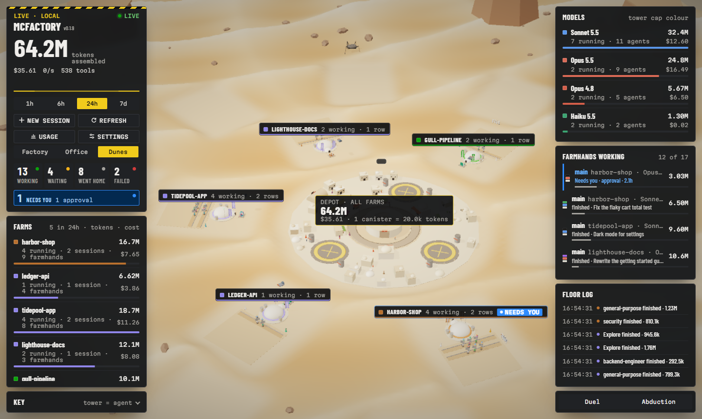
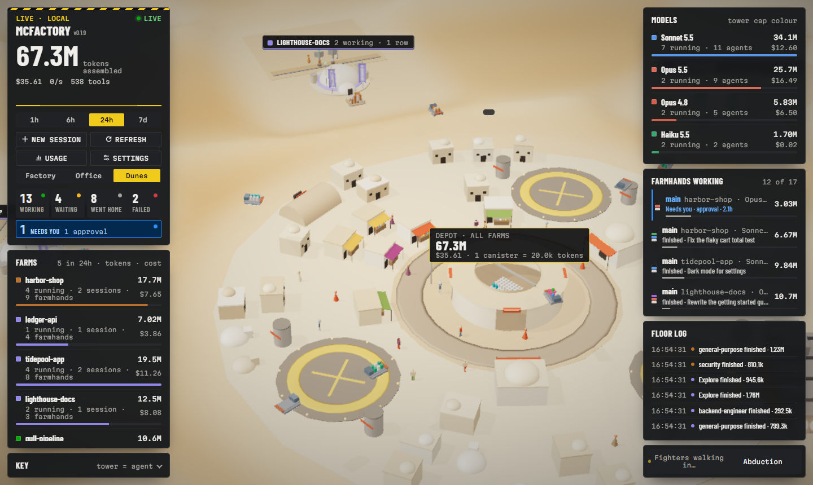
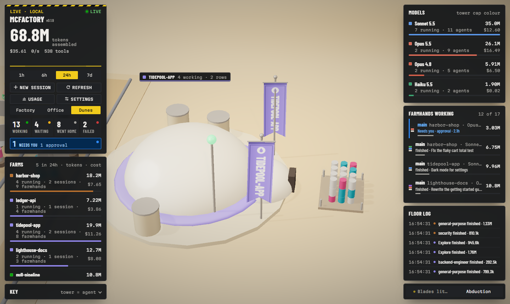
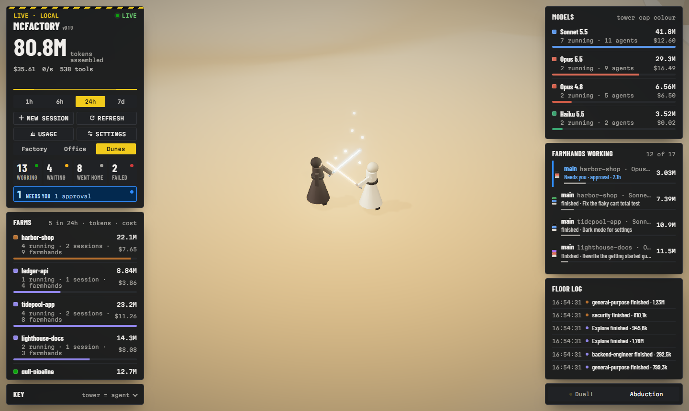
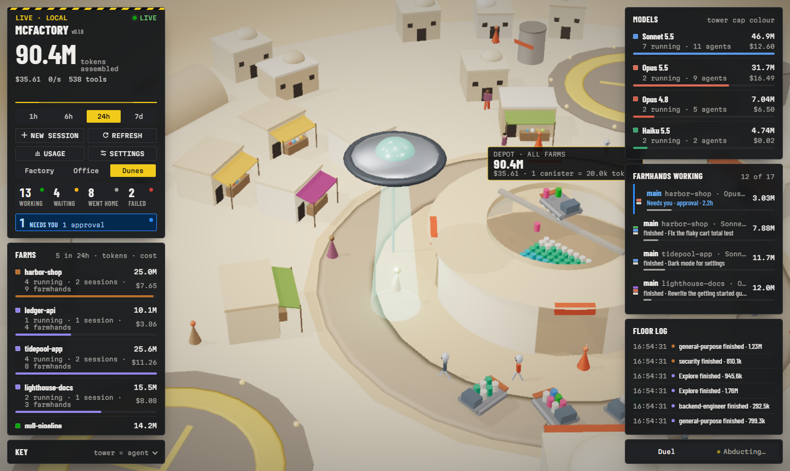

# The dunes view

The dunes view is a third scene for the same data: an overview of a desert planet under two suns. Projects become moisture farms on the dunes around a desert town, sessions become rows of condenser towers and agents become towers with a farmhand each. Nothing changes on the server: every scene reads the same `/api/state` snapshot.

| A duel on the dunes | A saucer abduction |
| --- | --- |
|  |  |

## Switching views

Use the **Factory**, **Office** and **Dunes** buttons, or open the page with `?view=dunes`. The choice is remembered in your browser, and switching reloads the page. Canisters still on their way (on a farm's pad or on a sled) are handed to the next view, as crates and drives are between the other two.

## What you see

| On screen | What it stands for |
|-----------|-------------------|
| Farm | A project: a domed homestead, a canister pad on the town side and the condenser field behind it. Up to 16 farms stand on two rings round the town; more projects show as a "+N more farms" sign. |
| Name banners | Two tall cloth banners in the farm colour flank the homestead door, with the project name written down them. They turn to face you, so the name always reads, and stir in the wind. |
| Homestead beacon | Blue flashing: needs you. Amber: waiting. Green: running. Red: failed. Dark: nothing open. |
| Condenser row | An open session, at most 5 per farm. Finished sessions' rows fold away. |
| Condenser tower | An agent, at most 8 per row. Band = role, cap = model, glow ring = effort. |
| Tower lamp and fins | Spinning fins and a green lamp: running. Amber: waiting. Red strobe: failed. Blue flashing: needs you. Dim: done. |
| Farmhand | The agent's helper, robe in the role colour. Walks round the tower while it runs, stands by it otherwise, sits when the main agent is done. When a subagent finishes, its tower sinks into the sand and the farmhand walks back into the homestead. |
| Water canister | About 20,000 tokens, in the role colour. Canisters hop from a tower onto the farm's pad. |
| Hover-sled | Transport. A sled lifts off its pad on the ring round the depot hall, flies over the rooftops to a farm, loads up to six canisters, flies back and hovers over the hall's roof opening to drop them onto the pile. One sled unloads at a time; the others wait over their pads. |
| Depot hall and pile | The round hall in the middle of town holds the canister pile: the window total (log scale), coloured by each role's share of the tokens. You see it through the roof opening and the doorways. Its sign shows the total and the estimated cost. |
| Wardens | Squads of four in white armour walk the patrol ring between the farm rings. When a farm needs you, the nearest free squad marches to it and stands guard by the homestead door until it no longer does. More squads come out of the garrison hall when all are busy. |
| Dune crawlers | Two big four-legged walkers on the outer ring. Scenery: they show no data. |

Wardens, farmhands, sleds and townsfolk go round buildings, homesteads, fields and towers instead of through them. Townsfolk also go round shop counters, awning poles and porches, and step aside to pass each other; when two meet head-on, both keep right.

### Scenery

These show no data; each can be turned off in **Settings**.

| On screen | What happens |
|-----------|--------------|
| The town | Houses, small domes, shops with awnings and goods on the counter, a cantina, fuel tanks and the garrison hall, round a plaza and the depot hall. Six lanes run out from the plaza. |
| Townsfolk | Humans and five kinds of aliens (grey with a bulb head, green with eyes on stalks, ruddy with horns, tall and violet with four arms, teal with chin tendrils). They walk the lanes from a shop counter to a door, the plaza or the edge of a bay, stop a while and move on. |
| Spaceport | Three landing bays in town. A courier, freighter, fighter or cargo shuttle comes in over the dunes, settles straight down while the bay lamps blink, sits a while with its engines off, then lifts and flies off another way. |
| Flybys | Now and then a ship crosses the part of the planet you are looking at, high up: a needle courier, a freighter, a vee of three fighters or a huge ore barge. |
| Blade duel | Now and then two robed fighters meet on open dunes in view, ignite their energy blades (amber and cyan) and fight. One yields and kneels, they bow and walk off. |
| Abduction | Now and then a saucer flies in over town and shines a pale green beam down on an alien in view. People nearby stop and stare while the alien floats up, spinning, into the saucer, which then shoots off. Nobody new walks into town for a little while after. |

The **Duel** and **Abduction** buttons under the right-hand panels start one right away and fly the camera there; while it runs, the button shows what is happening (for example *Beam on…*). Abduction is greyed out when there are no aliens in town.

Click a farm, a row, a tower or the depot to fly there; the drawer shows the same details as in the other views.

## Settings

The **Settings** dialog in the dunes view has:

- **Townsfolk in town, at most**: 0 to 40, 24 by default. 0 empties the streets.
- **Spaceport traffic**: ships landing and leaving. Turned off, ships already on a bay still leave.
- **Ship flybys**.
- **Blade duels**: a duel in progress finishes. Turned off, the Duel button is hidden too.
- **Saucer abductions**: an abduction in progress finishes. Turned off, the Abduction button is hidden too.

With reduced motion, townsfolk stand still, two bays hold a parked ship, there are no flybys, duels or abductions, and the Duel and Abduction buttons are greyed out.

## Code

The scene lives in `src/dunes/`: `terrain.ts` (site plan, town layout, dune heights, pad and pile spots, routing; pure, tested in `test/dunes.test.js`), `models.ts`, `world.ts` (suns, ground, town, depot hall, pile), `farms.ts`, `haul.ts` (canisters and sleds), `patrol.ts`, `folk.ts` (townsfolk), `port.ts` (spaceport bays and their ships), `sky.ts` (flybys), `duel.ts`, `abduct.ts` (the saucer) and `index.ts` (the scene API). The Duel and Abduction buttons are in `src/app/hud-dunes-button.ts`.
