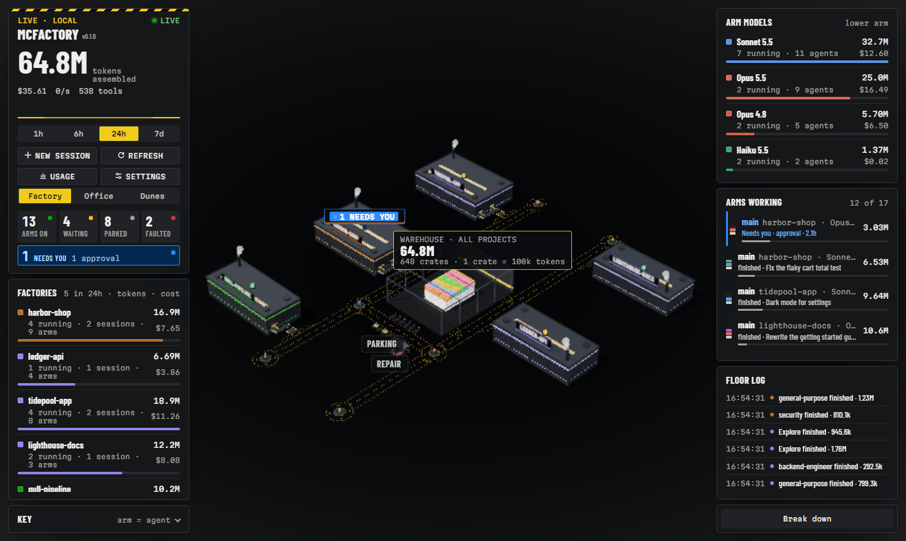

# The factory view

The page draws your Claude Code activity as an isometric factory. Everything on it comes from the session transcripts in `~/.claude/projects` and the session files in `~/.claude/sessions`.

## What you see

| On screen | What it stands for |
|-----------|-------------------|
| Factory hall | A project: the last folder name of the session's working folder. Up to 12 halls stand in a grid around the central warehouse; the rest are in the Factories list. Each hall has its name on a sign on poles along the front of the roof, a siren in the middle of the roof, and a subtotal sign. |
| Conveyor line | An open session. Live sessions come first, at most 6 per hall ("+N more sessions"). The line sign shows title, tokens and status. |
| Robot arm | A running or waiting agent on that session, at most 10 per line ("+N arms"). |
| Arm base, lower arm, upper arm | Role, model and effort (low soft yellow, medium green, high orange, xhigh purple, max black). All arms are the same size. |
| Pedestal gauge | The agent's tokens, as a log share of the biggest agent in the window. Lit cyan while running. Exact numbers are in the tooltip and the agent card. |
| Crates | Tokens, coloured by role. |
| Small yellow robots | Transport from the hall exits to the warehouse. |
| Warehouse pile | The total of the time window, by role. |

**Click** a hall to fly to it and open the project card, a line for the session card (its agents table focuses an arm when you click a row), or an arm for the agent card. Line signs show only in the hall you have open.

## Motion follows the tokens

An arm only picks and places when tokens arrive: new usage, or a token rate in the last 60 seconds. Every cycle carries one crate (about 20,000 tokens of rate per crate, at least one per arrival). A running arm with no token flow holds still over its pad.

Crates ride the line to the hall exit, and a cross conveyor feeds the outbound dock. Robots (2 to 12, scaled to the dock's throughput and backlog) carry up to 3 crates each to the warehouse pile. An empty robot drives 30 % faster than a loaded one; both slow down for bends the same way. Idle robots park at the charging bay. Every crate that reaches the dock is delivered.

### A stuck robot

Robots give way to each other at junctions and roundabouts. If they ever lock up, right-click a robot and choose **Drive**: it drives on for a few seconds and ignores the right-of-way rules, which clears the jam. Drive is off for parked, broken-down and towed robots. Esc or a click elsewhere closes the menu.

## Open and closed sessions

A session is **open** while a live Claude Code process holds it (`~/.claude/sessions/<pid>.json` with a living pid), or while its transcript changed in the last 5 minutes. Otherwise it is **closed**, and its end time is its last activity.

Only open sessions get a line. Closed sessions become cards on an info board on the hall's far wall, visible when that hall is open: name (aico ID, else title), tokens, cost, agents, duration and end time, newest first, at most 6 ("+N older"). Click a card for the session card. The hall's subtotal still counts closed sessions ("N open · M closed").

When a session closes, its line retires: the arms fold, crates already on the belt ride out to the dock, the line is removed and the other lines slide together.

## Status

| Status | Meaning |
|--------|---------|
| running | Active in the last 90 seconds |
| waiting | Idle for 90 seconds to 10 minutes, not finished |
| done | Finished, or idle for over 10 minutes |
| failed | Ended with an API error |

## Finished agents

A subagent that is done or failed loses its arm. If it holds a crate, it puts it on the belt first; then the arm folds and sinks into the floor (about 1.6 seconds, instant with reduced motion) and the other arms slide together.

A new arm only appears on an empty spot: while a removal crew still holds the line, or another arm still stands where it goes, it waits and then grows in. The main arm stays while the session is open. Arms are ordered main first, then subagents by start time.

Each open line has a small "N finished" sign under its line sign, with one role-coloured chip per finished agent (newest first, at most 12). Hover or focus it to see the rows: role, model, tokens, done or failed, duration. Click a row for the agent card.

## Needs you

A session that waits for you turns **blue**: a flashing beacon (steady with reduced motion), "needs you" on the line and hall signs, a KPI tile, blue rows in Arms working and a floor-log event.

The server reads this from `~/.claude/sessions/<pid>.json`, which Claude Code writes while the process lives:

- waiting for input: a **question** for you
- waiting for a permission prompt, sandbox request, worker request or goal proposal: an **approval**, shown on the agent with the newest open tool call
- idle, with the main agent active in the last 30 minutes: **your reply**

Without a sessions folder, the server falls back to the transcript: an open AskUserQuestion is a question, an open ExitPlanMode is an approval, any other prompting tool open for over 4 seconds outside bypass, dontAsk or auto mode is an approval, and a finished turn with no background agents means it is your turn.

## aico project IDs

A session that belongs to an [aico](https://github.com/therealmcsparrow/McAICompany) run shows its project ID (for example `P20261112.000001`) on the line sign instead of the title. The ID comes from the session's git branch (`aico/<ID>`) or working folder, else from the first prompt, else from the subagent descriptions. Only the ID itself leaves the server, never the text around it.

## Tokens and cost

**Tokens** are input + output + cache write + cache read, counted once per message, inside the chosen time window (1 h, 6 h, 24 h or 7 days).

**Cost** is an estimate at API list prices. `*` or `n/a` marks a model with no known price. It is not what a Claude plan charges.

## Refresh

The **Refresh** button beside New session rescans the session and transcript folders at once (instead of within 10 seconds), sends a new snapshot and reopens the live stream and any open chat. The page itself does not reload, so the camera, the open card and any text you typed stay.

## Settings

The **Settings** button beside Usage opens a dialog with the fun elements of the view you are in; the other views' settings show when you switch to them. Changes apply at once, without a reload, and are saved in this browser only.

- **Breakdowns, tow truck and repair shop** (on by default): now and then a robot breaks down, a tow truck takes it to the repair garage and mechanics fix it. The **Break down** button forces one. When off, no robot breaks down, and the garage, its Repair sign, the tow truck and the Break down button are hidden. A breakdown in progress ends at once: the robot is repaired and drives out of the garage door.
