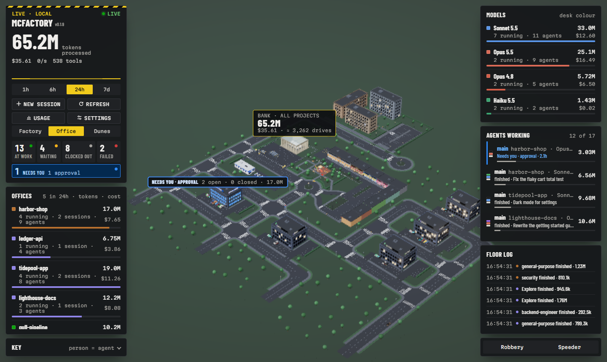

# The office view

The office view is a second scene for the same data. Projects become office buildings, sessions become desk rows and agents become people at desks. Nothing changes on the server: both scenes read the same `/api/state` snapshot.

## Switching views

Use the **Factory**, **Office** and **Dunes** buttons, or open the page with `?view=office` (or `?view=factory`). The choice is remembered in your browser, and switching reloads the page.

## What you see

| On screen | What it stands for |
|-----------|-------------------|
| Office building | A project. Offices stand on a grid all round the town centre, up to the **Offices in town, at most** setting (50 by default). The name is on sign boards on poles along the roof. See [Offices in town](#offices-in-town). |
| Windows | Lit while agents in that building work. Blue when a session needs you. |
| Roof siren | Blue flashing: needs you. Amber: waiting. Green: running. Dark: nothing open. |
| Desk row | An open session, at most 4 per building. |
| Person | An agent, at most 8 seats per row. Clothes show the role. |
| Desk top | The model. |
| Screen | The effort: low soft yellow, medium green, high orange, xhigh purple, max black with light text. Red screen: failed. Blue: needs you. Dim screen: done. |
| Glass manager's office | Where the main agents sit. It is against the east wall, with a door onto the floor. |
| Meeting room | An [aico](https://github.com/therealmcsparrow/McAICompany) brainstorm session. |
| Kitchen | An aico cooler session. |
| Agent vehicle | A person's own vehicle: a sports car (in the colour of their role), an SUV, a hatchback, a pickup or a motorcycle (about 1 in 7). The kind and colour follow from the agent ID, so an agent always comes in the same one. It parks nose-in and reverses out. |
| Time clock | A person punches in or out when they arrive or finish. |
| Board on the wall | Closed sessions, as in the factory view. |
| Police station | South of the street, east of the avenue. Three patrol cars and a SWAT van park in its bays. With more than 20 offices, smaller stations stand among the offices (see [More police stations](#more-police-stations)). It is scenery: it shows no data. |
| Patrol car and officer | Traffic police. A car comes out when traffic is stuck, and the officer waves vehicles on. |
| Shops | Eight shops in an L round the bank's north-east corner, by the east roundabout. Shoppers and visiting cars and motorcycles. They stand for how many agents are running, not for any one agent. See [Shops](#shops). |
| Motorcycle | A shop visitor, or an agent's vehicle. At the shops it parks in the motorcycle spots at the west end of the car park. |
| Box truck | A delivery to the shops, or through traffic. Most carry a shop's name on the side. See [Shops](#shops). |
| Van, bandits, SWAT | An armoured car robbery, if that setting is on. It is a cartoon and has no meaning for your data. |

The legend in the page repeats the colour keys for roles, models and effort.

### People

- A running agent types. A waiting agent has a coffee cup.
- A subagent appears the moment the main agent sends it out: it walks out of the manager's office to its desk, and its car is already parked. The main agent drives in through the gate.
- A subagent that another subagent sends out is a worker of its own, at its own desk, like every other subagent.
- A finished subagent clocks out, walks to its car and drives off. The main agent stays while its session is open.
- People never walk through each other. The front door, the lobby with the time clock and the path to the cars run one way at a time: newcomers wait in their car while people leave, and leavers wait at the end of the desk area while people come in. At most four people walk through at once. When many agents finish together, the rest stay at their desk until there is room.
- In the meeting room and kitchen there is one person per role. A speech balloon with dots shows while they speak. It never contains text.
- A person who needs you has a blue marker, and their screen turns blue.

The room is set by the name of the command or skill that started the session (see [mode in the API](api.md#session-mode)).

## Data and the bank

While an agent works, role-coloured blocks run along the cable to the server at the dock. One drive stands for about 20,000 tokens. An armoured car with guards takes the drives to the bank and reverses into its bay. Until a car picks them up, the drives pile up on a pallet beside the dock, 12 to a layer, so the pile keeps growing while agents work faster than the cars can carry. A dock holds at most 300 drives; drives beyond that are not drawn (the token totals still count them).

The bank is east of the avenue, fenced, with a barrier gate on its in road and its out road. A gate opens only for an armoured car, as soon as its way runs through the gate within the next 16 m, so it is already open when the car turns in off the street. Drives are stacked inside it, and the bank label shows the total of the time window.

An armoured car carries up to 10 drives. When fewer than 10 drives wait at a dock, a car is sent for them after a few seconds. On the street an empty one (on its way to an office, or back to its bay with nothing) drives about 30 % faster than a loaded one; in the yard, the lay-by and when it reverses it keeps the same speed. The bank has 16 bays in two rows of 8, one behind the other, and each row has its own in and out lane. Each office gets as many armoured cars as its pile needs, from 1 up to 10: one per layer of its pile (12 drives), and at least enough to carry what it makes in one round trip, with a fifth to spare. How fast the pile grows is measured every 5 seconds, and the round trip is measured from its own cars (60 seconds until the first one is back). So a quiet office has one car, and a busy one has several on the road at once. The number goes up as the pile grows and down as it shrinks: while an office has as many cars on a run as it wants, no new car goes out for it. At most 10 armoured cars are out on a run at once, all offices together (on the way to an office, loading or on the way back), so the queue for the yard never reaches the street; the office whose drives have waited longest gets the next car. A loaded car always drives back at once. The lay-by beside the dock holds two armoured cars nose to tail, so two cars can load at the same office at once. A second car comes only for a full load while the front spot is taken, and no new car comes for the front spot while the rear car is still loading. An office that needs more than two cars also gets one car ahead for each spot (two for each spot when it needs more than five), for a full load. Every car claims its spot on the in road, first come first served, and waits there until that spot is free; the front spot also waits until the rear car has gone, because the rear car leaves through it. An armoured car never waits at the dock: it leaves as soon as it has 10 drives or the pile is empty. The rear car starts loading only once the front spot is clear, so it never stands full behind a car still loading. A car leaving the lay-by and a car backing out of its parking spot meet where the forecourt lane turns onto the out road, so they take turns: whoever goes first holds the forecourt, and the one that waited is next. The yard has two lanes: cars come in on the lane by the fence and leave on the lane by the bays. A car reverses into its bay, or pulls out of it, only while no other car is using that part of the yard. The car for the bay next to the out road waits 3 m before its stop until that part of the yard and the out road are clear, then drives in and reverses without stopping, so its nose never stands in the way of a car on the out road. A car on the out road also waits until the short stretch of street to the next roundabout has room for it. When it leaves, an armoured car waits for both lanes of the street, because its nose swings over the far lane. A loaded car leaves the lay-by at once, and the next car can come for that office right away. Vehicles turn only while they roll, never on the spot.

## Offices in town

Offices stand on a grid of streets all round the town centre: the bank, the shops, the police station, the apartments and the park. They fill ring by ring, nearest the centre first, and evenly on every side. The cells where the centre stands are kept free. The **Offices in town, at most** setting (12 to 100, 50 by default) caps how many are drawn. When there are more projects than that, the busiest and most recent projects get an office first, and they get the cells nearest the centre.

West of the avenue the office streets run west as before. East of the centre, past the shops, a second avenue runs north and south. Office streets leave it to the east, and the streets south of the centre run on east to it. North of the centre, offices east of the avenue sit on short streets that end at a turnaround. Projects beyond the cap get no building; their tokens still count at the bank. Empty grid cells cost nothing per frame. The overview fits the offices that stand, and it fits again when the setting changes.

## Shops

Eight shops stand in an L round the bank's north-east corner, with a car park inside the L. The east leg faces the east roundabout: a bakery, a café, a grocer and a pharmacy. The north leg runs west along the back of the bank, on the side away from the bank street: a florist, a bike shop, a bookshop and a hardware store. Each shop has a sign and lit windows. The site is reached by a short road that leaves the east roundabout to the east. That road has one lane each way, and it is the only way in for vehicles. There is no access from the avenue side. At the west end of the north leg, behind the hardware store, is a loading bay. A service drive runs to it from the west end of the car park, along a planted strip with trees and benches.

Box trucks bring deliveries. A delivery comes in through the gate and drives to the shops like a visitor. It goes west along the first aisle and up the service drive, and reverses into the loading bay. It unloads for a few seconds, and crates appear by the side door. Then it drives back down, out along the second aisle and back to the gate. Other box trucks are through traffic: they drive round the town and leave by the gate again. At most one delivery and two box trucks are out at once. They come more often when more agents run. Trucks take their turn with the visitors: only one vehicle drives in at a time, and nobody reverses out of a spot while a truck passes. The trucks follow the **Shops and shoppers** setting. With reduced motion no truck comes.

The car park has 14 car spots and 6 motorcycle spots in one row along the north leg, and it is one way. Vehicles come in on the entry lane, drive west along the first aisle and park nose-in in a free spot. Visitors come by car or by motorcycle, in through the gate. The driver gets out and goes shopping on foot. Afterwards the vehicle reverses out of its spot, drives on to the west end, turns round the island and comes back east along the second aisle to the exit lane and out through the gate. Nobody comes when every spot is taken, so there are never more visitors than spots. In the car park, nobody reverses out while someone is driving into a spot, and nobody drives in while someone reverses out.

How many visitors come follows the same count as the shoppers. With no agent running, a car or motorcycle comes now and then. With 12 or more running, they come one after another, and up to 16 may be at the shops, but never more than the **Shop vehicles** setting allows. Only one visitor drives in at a time, so the avenue does not fill up with shop traffic; in practice 5 to 9 are at the shops at once. With reduced motion nobody drives: cars and motorcycles stand parked in their spots, more of them when more agents run.

Shoppers on foot come in along the footpath at the east end and at the far end of the north leg. They walk the pavement, round the corner of the L where needed, to a shop door, go inside, and come out 10 to 40 seconds later. The shops have sliding glass doors. A door slides open when a shopper comes up to it, and closes once they are through. Coming out works the same way. Drivers walk from their spot to the pavement and back. Shoppers stay on the pavements and footpaths, keep to the right, and never walk through each other. How many are about follows how busy you are: the number of running agents across all offices. With no agent running, one shopper walks about and the shop windows are dim. With 12 or more running, 12 shoppers are about (or as many as the **Shoppers on foot** setting allows) and the windows are fully lit. The shoppers are a cartoon: they stand for nothing in your data beyond that count. With reduced motion nobody walks and the doors stay shut: a few shoppers stand still at the shop windows, more of them when more agents run.

## Going home

When an agent finishes, their own vehicle reverses out of its spot as before. Most then drive home to the apartments north of the top office row. About one in three drives to the shops first. It parks in a free spot of its kind, and the driver walks in through the sliding doors, shops for a while and walks back. Then the vehicle drives on home. Pickups do not stop at the shops.

At the apartments the vehicle parks in a free car or motorcycle spot. The driver gets out, walks to the door of their block and goes in. A few more windows light up for each agent at home. After one to two and a half minutes the driver comes out, walks back and drives off out of town. When the road is busy, the parked vehicle fades out instead. So the car park never fills up for good.

At most three of these trips run at once, and only one agent shops at a time. Other agents who finish then drive off out of town, as before. They also do that when the apartments' car park is full, or when the shops have no room. In the apartments' car park, nobody drives in while someone reverses out, and nobody reverses out while someone drives in.

With reduced motion nobody drives or walks. The vehicle of an agent who finishes stands in a spot at the apartments for a while, and their windows are lit.

## Roads

Every road has two lanes each way: the avenue, the street east of the avenue past the bank, every office street and the in roads. Every roundabout on the south edge of the town has an in road going south, with two lanes each way, sidewalks and a solid centre line. Traffic from outside comes in on a random in road and leaves by a random one: agents' cars, shop visitors, box trucks (also through traffic), armoured cars from outside, the bandits' van and the extra armoured car in a robbery. Each in road has its own queue for vehicles waiting to come in. The short road from the east roundabout to the shops is also one lane each way. Vehicles keep to the right-hand (outer) lane and move to the inner lane only to turn left at the next roundabout, in the last stretch before it. Every forecourt has an in road and an out road. Vehicles keep their distance and never overlap.

Where roads meet there is a junction: where each office street meets the avenue or the east avenue, at the east end of the bank street, and on each office street just west of every office, between neighbouring offices and after the last one, where the street ends. Offices stand 60 m apart along a street, so there is room for a queue on both sides of each junction. Rows of offices are 33 m apart, which leaves a short straight on the avenue between its junctions. What a junction looks like depends on how many roads meet there:

- Where only two roads meet, the road just runs on.
- Where three roads meet there is a T-junction. The through road has the right of way, and the side road gives way at a line of shark's teeth. Some T-junctions have traffic lights instead, picked at random for each town.
- Where four roads meet there is a roundabout or, picked at random for each town, a crossing with traffic lights.
- A road that ends (one arm) has a roundabout to turn on. The roundabouts east of the apartments and east of the bank street always stay roundabouts.
- Shark's teeth also mark the line at every out road and at every roundabout entry.
- When offices stand in the row north of the apartments, east of the centre, a road runs east from the roundabout east of the apartments to the first of them.

Roundabouts have two lanes.

- Vehicles on a roundabout have the right of way. A vehicle takes the first exit from the outer lane of the ring and goes straight on from either lane. It turns left or makes a U-turn from the inner lane. A car that enters in the outer lane waits only for traffic that will be in the outer lane at its entry. It does not wait for traffic that goes past in the inner lane. A car that enters in the inner lane crosses the outer lane, so it waits for both lanes. Either one waits only for a vehicle that would reach its entry before it has pulled in and cleared it. That is worked out from the speeds, not from a fixed distance. Every vehicle also waits until there is room for it past the exit it takes. Armoured cars, vans and units with their lights on keep the cautious rule: they wait until the ring is clear upstream.
- A vehicle in the inner lane of a roundabout moves over to the outer lane before its exit and leaves from there. It moves over only when the outer lane has a gap, and it gives way to traffic in the outer lane. Without a gap it first slows down, and if the gap still does not come it stops in the inner lane where it would move over. A vehicle entering in the outer lane also waits for a slow vehicle just past its entry that is moving over into the outer lane.
- A vehicle changes lanes on a street only where the lane change is marked out, on a 12 m stretch that ends 7 m before the next roundabout. It changes lanes only when the other lane has a gap ahead of it and behind it, judged from the speeds. A vehicle that stands still ahead must be past the end of the lane change, so nobody ends up standing across both lanes. Without a gap the vehicle slows down and waits in its own lane at the start of the lane change. A slow vehicle that comes up in the other lane stops short of it and lets it in. A vehicle that has waited a long time settles for a smaller gap, but never cuts in close in front of another vehicle.
- At a T-junction the side road gives way to everything on the through road. A vehicle turning left off the through road gives way to oncoming traffic. Nobody drives onto a junction unless there is room past it, so the junction is never blocked.
- Traffic lights let one road go at a time on a 27-second cycle: 9 seconds green, 2.5 seconds amber, then 2 seconds with all lights red before the other road gets green. Vehicles stop at the stop line on red and on amber when they can still stop in comfort. A vehicle that waits at the line to turn left may still go in the first 1.8 seconds of amber. Every junction has a zebra over each arm, just inside the stop line.
- A unit with its siren on drives through red and through a give-way line, and everyone else waits for it, also on green.
- Lanterns stand on the verge along every straight road, every 24 m, on alternate sides.
- Traffic on the street has the right of way over an out road. Every vehicle may turn left out of an office's or the bank's out road across the near lanes, and from the far lane across the near lanes into an in road. It waits for a real gap: nothing moving in the lanes it crosses or joins from about 24 m back. The line at an out road is far enough back (2.7 m for a car, 3.3 m for an armoured car) that a vehicle passing in the outer lane never has to stop for the one waiting there. In roads leave the street from the outer lane.
- Where an out road joins the street (at every office, the bank and the police station), a box is marked on the road: nobody stops in it. A vehicle waits before the box until there is room past it.
- Two vehicles that each stop for the other (a turning armoured car's tail and a vehicle beside or behind it) do not wait for good: either goes on if it keeps a small distance, and if neither can, after 3 seconds the one in front goes on as long as it does not touch. A vehicle that stops behind a turning armoured car stops well back, so its tail can swing round.
- Nothing waits on the street for a forecourt or the bank. A car waits in its spot, and an armoured car in its spot of the lay-by beside the dock, until the way is free.
- Every straight road has a 1.4 m sidewalk and a 1 m grass verge on both sides, with trees beyond. Round each roundabout the sidewalks run on as arcs, and a zebra crosses each arm a few metres back from the yield line. The sidewalks stop where an in or out road crosses them and where a lot or yard lies. Footpaths with zebras link the shops to the street. Each office has a side car park east of the building, with a hedge on its east side. The open ground is grass with trees, and the grass runs on past the screen edges at any number of offices, also zoomed all the way out.
- A park lies by the east roundabout, with paths, lamps, benches and a hedge. Its playground has swings, a slide, a climbing frame, a sandbox and a see-saw on a soft floor.
- Kids play in the playground. They swing, slide, climb, dig in the sandbox, ride the see-saw and play tag on the grass, and walk round the equipment rather than through it. A parent or two sit on the benches and stay seated while the number of kids changes: a second parent comes at 7 kids, leaves at 4 or fewer and stays at least a minute, and kids leave only after the count has stayed lower for 20 seconds. The busier the agents, the more kids there are, from 3 to 16, but never more than the **Kids in the park, at most** setting.
- People walk their dogs on the sidewalks all over town. They cross the roads at the zebras, where people on foot have the right of way: a walker steps on only when the cars coming can still stop in comfort, cars stop before the stripes while someone is on them, and a siren unit goes first. A car about to leave a roundabout waits at the yield line rather than stop with its tail on the ring. Walkers do not stop on a zebra to chat or let the dog sniff. The dog stays on the sidewalk: it follows its walker's route round corners rather than cutting across, sniffs the grass on the side away from the road, and steps onto the road only with its walker (on a zebra or over a dropped kerb). They stop when the dog sniffs a tree or a lamp post, and some come out of or go into the flats. The **Dog walkers, at most** setting caps how many there are.
- Vehicles use turn signals: amber lamps blink on the side they turn to, and on a roundabout when they are about to leave it. A vehicle that waits does not wait for one that signals it will turn off before it gets there. An armoured car or van still waits for another wide vehicle that leaves at its own arm of the roundabout. The lamps show only while a vehicle signals or has its hazard lights on, and only on that side. They blink even with reduced motion, because a steady lamp looks as if it is always on.

### Traffic police

When traffic is stuck, one patrol car leaves the police station with its lights flashing. Traffic counts as stuck when a vehicle has been held for more than 5 seconds, or when 3 or more vehicles stand still one behind the other. The car stops on the shoulder behind the queue. Where there is no shoulder, as on the lane along the bank fence, it stops in the lane itself with its hazard lights on, away from roundabouts and junctions; vehicles behind it wait and do not count as stuck. The officer gets out and waves the waiting vehicles on, one at a time. Each vehicle still keeps its distance from the others. When nothing has waited for about 6 seconds, the officer gets back in and the car drives back to the station. Only one car goes out at a time, and after a call-out the station waits a while before the next one. With reduced motion the lights stay steady and the officer does not wave.

A patrol car or the SWAT van on its way to a call-out or a robbery has its lights on and the right of way everywhere. Vehicles that want to enter a roundabout, or leave an out road, wait for it. While it waits to pull out (from the station's out road, or across the street for a short cut), traffic that would drive into its path stops short, also at the roundabout line before it. A queue standing in front of it moves on as if it had the lights on, so the unit is not held behind it. It enters a roundabout even when the ring is busy, unless a vehicle is right at its entry. Vehicles ahead of it in its lane move over and slow down to let it pass: from the inner lane into the outer lane when that is clear beside them, from the outer lane onto the shoulder where the shoulder is straight and free. They move back once it has passed or is 30 m or more away. They move back only when the lane has a gap, judged from the speeds as for a lane change, and a slow vehicle coming up in that lane lets them in. One that sees a car come up while it is still mostly on the shoulder goes back onto the shoulder until the car has passed. A siren unit that stands in a queue does not hold up other traffic. It never drives through another vehicle. It may also take short cuts: a left turn at a roundabout straight over the island instead of three quarters of the way round, a left turn from an out road across the near lane (for example out of the police station towards the west), and a U-turn across the street into the lane of its stop, 6 to 8 m before it. It takes a short cut only when that way is shorter. Before it crosses a lane it waits until that lane is clear near the point where it joins, and it still waits for anything physically in its way. Traffic in the lane it joins and the lane beside it stops a few metres before that point while the unit comes up to the cut and crosses, and a vehicle already standing at that point (say at a roundabout line just past it) goes first. If the lane stays busy for about 8 seconds, it drops the U-turn and drives the normal way round. Vehicles that would end up on the shoulder right next to its stop do not move over. It does not make a U-turn into a lane where a queue stands or where something is parked on the shoulder at that spot. A vehicle parked on the shoulder at the stop itself, such as the robbed armoured car, does not stop the U-turn. A vehicle that stops for a unit crossing in front of it stops well back, so the unit's tail can swing round. On its way out of the station the unit waits until both eastbound lanes are clear from the west, and for traffic that is about to come off the avenue roundabout or change lanes into them. It does not wait for a vehicle that stands at the roundabout's line. On the way back to the station the lights are off and it follows the normal rules.

### More police stations

The town gets one police station for every 20 offices drawn: one up to 20 offices, two up to 40, three up to 60, and so on, five at most. The extra stations stand in office cells spread round the town, away from the centre, so those cells hold no office. Each one is a smaller copy of the main station, north of its street, with its own in and out roads and its own two patrol cars, spare patrol car and SWAT van. A station has no robbery stretch in front of it.

A jam call goes to the nearest station with a patrol car at home, and to the next nearest when that one has none. A robbery is answered by the nearest station with both patrol cars and the SWAT van at home. The light bar sits on the roof of the station that answers. Every unit goes back to its own station, and patrol cars leave from and go back to any station. When the number of offices drops, a station that is no longer needed goes once all its units are back home.

### Patrols and speeders

Patrol cars cruise the town. The **Patrol cars** setting sets how many (0 to 4, 2 by default). Each one leaves the police station, drives a random round past a few roundabouts and goes back in. Then another one comes out. A patrol car follows the normal traffic rules. It has no siren right of way, and it moves over for a unit with its lights on like any other vehicle.

Every few minutes, while a patrol car is out, a car speeds. It drives faster than the others, but it still keeps to every traffic rule: it waits at the lines and roundabouts and keeps its distance. A patrol car just behind it turns on its lights and follows it, never closer than about 6 metres (on a roundabout it waits rather than close up). The lights flash, but the patrol car has no right of way. Both cars pull onto the shoulder on a straight stretch. They never stop on a roundabout, at a junction or in front of an in or out road. The officer walks to the driver's window. Both get speech bubbles in made-up words, and the officer writes a ticket and hands it over. Then both cars go back into the lane when it is clear, and the patrol car drives back to the station.

There is only one traffic stop at a time. A robbery or a jam call comes first. While one is on, no patrol car comes out and no car speeds, and a stop that is going on ends at once. When you lower the setting, patrol cars above the new number drive straight back to the station. With reduced motion the stop still happens, the lights stay steady and the officer does not bounce.

### Armoured car robberies

If the robbery setting is on, now and then bandits rob an armoured car, on average once every 7 minutes. Their van comes in through the gate and drives through the streets like any other vehicle, to a spot on a street. The spot can be anywhere on any straight street of 32 m or more, in either direction: past an office, between two offices, or on the street by the apartments. It is never on a roundabout, on the bank's or a police station's own street, or on the short links between two roundabouts. Spots on the way of a loaded armoured car are picked more often, and the same spot is not picked twice in a row. Mostly the van waits on the shoulder just before the spot and cuts in front of a loaded armoured car when it comes by. One time in three it stops the car head on: it waits on the far shoulder ahead, facing the car, and swings across the street into its way, nose to nose. The armoured car pulls over, 2 or 3 bandits get out, and an amber light and a "!" sign show above the scene. The light bar on the roof of the police station that answers flashes blue and red from that moment until the scene is cleared. Two patrol cars and the SWAT van drive over from that station, the nearest one with all three at home (the second patrol car parks well ahead of the van, so traffic can pass), the SWAT team aims, and the bandits put their hands up and are taken away. Speech bubbles show what is said, in made-up words: the bandits shout while they hold the armoured car (sometimes in swear symbols), the SWAT team barks orders, and during the arrest the bandits protest and the police answer. The bubbles go when the scene is cleared. Bubbles close together move apart so they do not overlap, and they stay between the side panels. The van disappears, the police drive back to the station, and the armoured car goes on to the bank with all its drives. If no armoured car comes by within 25 seconds, an extra armoured car comes in through the gate and drives past the van. It carries no drives of yours, and it leaves the site by the gate afterwards. If nothing comes by at all, the van drives off again. The **Robbery** button below the floor log starts one now and shows each step. It is greyed out while the police are out, and hidden when the setting is off. Only one robbery happens at a time, and none happen with reduced motion. Turning the setting off ends a robbery at once. Nothing new is fetched or sent: the scene is drawn from the same data.

## Camera

Drag to rotate and tilt the view, right-drag to pan, scroll to zoom. The camera stays where you leave it; Esc or the back button returns to the overview.

## Click

- **A building** opens it: the camera flies in and the roof fades away.
- **A person** puts the camera at their desk, and their screen is the detail card. Esc or the back button (labelled "Office · Esc" here) returns to their office; a second Esc returns to the overview.
  - **Main agent**: the [chat panel](chat.md) appears as the monitor, with the same rules as in the factory view.
  - **Subagent**: a read-only screen shows its own assistant text and its tool names with a short summary. You cannot send, stop or answer from it. To message the session, open its main agent.

The screen of a subagent is read only while it is open. See [Security and privacy](security-and-privacy.md#subagent-screens).

### Window stories

- **A lit window** of the apartments plays a short story in somebody's home. The camera flies up to the window and looks straight through the glass, with the wall and the window frame round it. The curtains open, the story runs for 10 to 30 seconds with captions under the window, and the curtains close.
- There are 20 stories, such as a midnight snack, a proposal, a burnt dinner, a new puppy, a magic show and a reunion in the rain. Each lit window gets a random one, and the stories are shuffled again on every load.
- The cursor turns into a pointer over a window you can click. Dark windows, and windows hidden behind another building, do nothing.
- **Watch again** replays the story. Esc, **Back** or a click anywhere else draws the curtains and flies the camera back to where it was. You cannot turn or zoom the camera while you watch. On a narrow screen (below 820 pixels) the side panels hide while you watch.
- With reduced motion, the camera jumps to the window and back without flying, and the story shows one still picture per caption instead of the animation.

The stories are a cartoon. They stand for nothing in your data, and nothing is fetched or sent.

## Settings

The **Settings** button beside Usage opens a dialog with the fun elements of this view (the factory view's show there). All settings are saved in this browser only and apply at once, without a reload.

- **Offices in town, at most** ): 12 to 100, 50 by default. See [Offices in town](#offices-in-town).
- **Patrol cars** ): 0 to 4, 2 by default. 0 means none. See [Patrols and speeders](#patrols-and-speeders).
- **Dog walkers, at most** ): 0 to 20, 6 by default. 0 means none. When you lower it, walkers above the new limit head home, and nobody new comes until there are fewer.
- **Kids in the park, at most** ): 0 to 16, 12 by default. 0 means an empty playground: the kids and parents go home.
- **Armoured car robberies** (on by default). When on, now and then bandits stop an armoured car; police and SWAT arrive and arrest them.
- **Shops and shoppers** (office view, on by default). When off, the shops still stand, but the shoppers and the visiting cars and motorcycles are gone and the shop windows are dark. See [Shops](#shops). Two sliders below it set the most there may be at once. Each shows its current value. The arrow keys change a slider by one, and Home and End go to either end. A slider is greyed out while Shops and shoppers is off.
  - **Shoppers on foot, at most**: 0 to 30, 12 by default. Drivers who walk from the car park come on top of this.
  - **Shop vehicles (cars and motorcycles), at most**: 0 to 20 (the number of spots), 20 by default.

  The number of running agents still sets how many come, but never more than the slider; 0 means none. When you lower a slider, nobody new comes until there are fewer, and those already there finish their visit.

## Reduced motion

With the system setting "reduce motion", animation is steady or static: the siren and windows stay at one brightness, people appear at their seats instead of walking, shoppers stand still at the shop windows, kids stay still at the equipment, dog walkers stand with their dogs sitting, the shop doors stay shut, no box trucks drive, finished agents' vehicles stand at the apartments, window stories show one still per caption, and balloons show a fixed state.

## For developers

`window.__office` is a read-only probe: `stats()`, `seats()`, `traffic()` (its `held` list names any vehicle blocked for more than 5 seconds, and `minAt` the two vehicles that came closest so far), `yard()` (every moving vehicle in or by the bank yard, with who holds it up and the wait it stands at) and `step(sec)`, which advances the scene. `police()` and `robbery()` return the state of the police and of a robbery, and `look(x, z, zoom)` points the camera at a spot. These three are not read-only when you give them a command: `police('call', x, z)` sends a patrol car to the road nearest that spot, `police('jam', x, z)` blocks the nearest roundabout for 35 seconds, `robbery('start')` sends the bandits' van out as soon as the police are at the station, and `robbery('soon')` makes the timer run out now. `robbery()` also returns `at` (the spot), `vanAt` (where the van is) and `staged` (an extra armoured car was sent). `shops()` returns the state of the shops: `walkers` (the shoppers, with `doors`, the shop doors that are open now) and `boxes` (the box trucks). `shops(b)` sets how busy the shops are (0 to 1) and `shops(null)` goes back to the agent count. `patrol()` returns the patrol cars (phase, position, speed and how far on the shoulder), the traffic stop going on, and counts of patrol cars sent out, speeders, stops and stops that ended early. `patrol('speed')` makes a car speed now and a patrol car stop it: the nearest car ahead on a cruising patrol car's route. If none comes along within about 5 seconds, a car joins the patrol car's route 30 to 60 metres ahead of it (up to 90 metres when a roundabout or a queue fills that stretch) and fades in, so the chase starts within about 10 seconds. If no patrol car is out, one comes out first. The request is dropped when it cannot happen: patrol cars set to 0, or a robbery or jam call starts. `homes()` returns the agents going home: how many drive, shop, stand parked at the apartments and are at home, how many windows are lit, and running totals. `homes('force')` makes a seated agent finish now and go home, past the odds and the limit; `homes('force', 'shop')` or `homes('force', 'home')` picks the way. `homes('off')` stops new trips, so finished agents drive off out of town as before, and `homes('on')` starts them again. `rings()` lists the roundabouts as `[x, z, number of arms]`, and `junctions()` lists the T-junctions and lit crossings as `[x, z, arms, lit, main, lights]`: `arms` names the arms (0 east, 1 south, 2 west, 3 north), `main` the axis with the right of way and `lights` the state of each axis (`g`, `a` or `r`). `peek()` returns the window story that is open (`open`, `phase`: `in` while the camera flies to the window, `on` while the story plays, `out` on the way back; `win`, `story`, `t`) and how many stories and lit windows there are. `peek('open', w)` opens the story of window `w`, or, given a story ID such as `'spider'`, opens that story in the first lit window. `peek('seek', t)` jumps to `t` seconds, `peek('close')` closes it, and `peek('where')` adds `at`, the lit windows on screen as `[window, x, y, faces the camera, clickable]`. The probe is for tests and debugging.

`window.CWFun` holds the settings: `get(key)` returns the stored value, or its default, `set(key, value)` saves it, and `on(fn)` calls `fn(key, value)` after every change. A change also fires a `cw-fun` event on `window` with `detail: {key, value}`. The toggles `breakdowns`, `robbery` and `shops` are booleans, and an unknown key reads as `true`. The numbers `shopWalkers` (0 to 30, default 12), `shopCars` (0 to 20, default 20), `officeMax` (12 to 100, default 50) and `patrols` (0 to 4, default 2) are whole numbers: `set` rounds a value and keeps it in range, and `get` does the same for a stored value. Everything is stored as JSON in `localStorage` under `cw.fun`.
